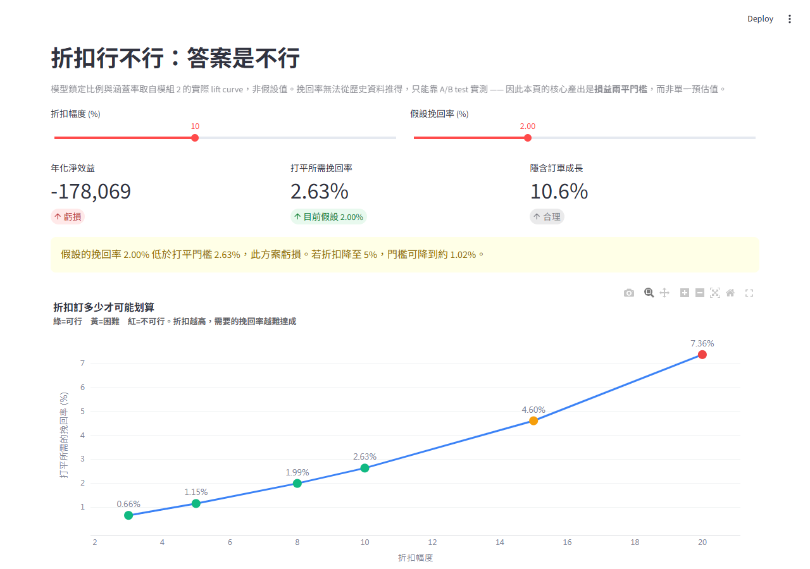
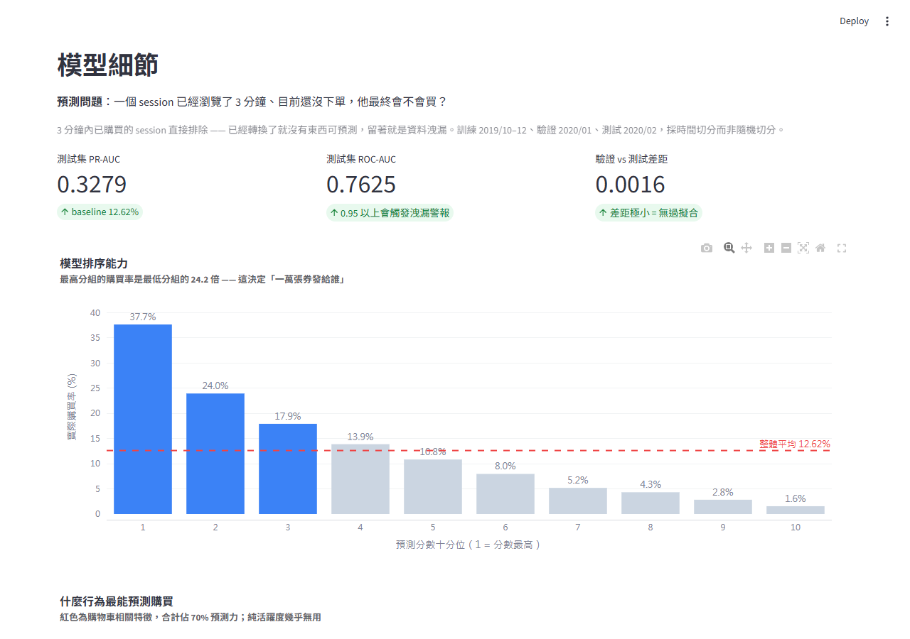
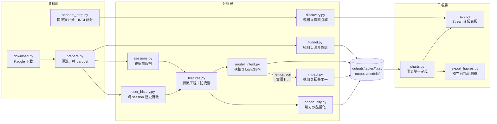

# 美妝電商決策系統

> 用 2,069 萬筆真實電商行為與 109 萬則商品評論，從「轉換漏在哪」一路做到「該把錢花在哪、值多少」：漏斗診斷 → LightGBM 購買意圖預測 → 損益兩平試算 → 膚況導向商品探索，最後包成可互動的 Streamlit 儀表板。

📊 [完整分析報告](docs/分析報告.md)　|　📐 [專題規格書](docs/專題規格書.md)

## 要解決的問題

一家美妝電商知道「轉換率不好」，但不知道**哪個環節在漏、漏掉多少錢、該優先修哪一個**。常見直覺是「對放棄購物車的人發折扣」，這個專案用資料檢驗這個直覺，並找出更划算的槓桿。

| 問題 | 結論 | 來源 |
|---|---|---|
| 哪一段流失最嚴重？ | 購物車：481 萬次加購中 419 萬次未成交（87.0%） | `outputs/tables/funnel_overall.csv` |
| 是價格造成的嗎？ | 不是：五個價格帶的加購後放棄率全距約 2.5 個百分點 | `docs/分析報告.md` 模組 1 |
| 能即時預測購買意圖嗎？ | 前 20% 高分 session 涵蓋 48.8% 的購買者（2.44 倍） | `outputs/tables/model_topk_capture.csv` |
| 發折扣挽回划算嗎？ | 合理情境年化淨效益 −461,075 ～ −178,069，需 2.63% 挽回率才打平 | `outputs/tables/impact_sensitivity.csv` |
| 那該做什麼？ | 推動「第一件加購」：0→1 件讓購買率從 7.34% 升到 20.23% | `outputs/tables/cart_curve.csv` |
| 值多少錢？ | 轉化 5% 零加購 session → 首年淨效益 +123,448，打平門檻 0.98% | `outputs/tables/opportunity_scenarios.csv` |

> **貨幣單位**：REES46 行為資料的 `price` 欄位原始來源未標示幣別，本專案一律以「一致的貨幣單位」表述，所有結論都是相對比較（損益兩平門檻、方案對照），不受幣別影響。Sephora 資料則明確為美元（`price_usd`）。

## Demo

儀表板（`streamlit run app.py`）依決策脈絡分成 5 頁：① 問題在哪 → ② 折扣行不行 → ③ 那該做什麼 → ④ 模型細節 → ⑤ 怎麼驗證與限制。以下為本機以 repo 內附的產出檔執行的截圖。

**② 折扣行不行**：拉滑桿調整折扣幅度與挽回率，即時算出年化淨效益與損益兩平門檻。



**④ 模型細節**：時間切分下的測試集指標與十分位提升表。



目前沒有線上部署，需在本機執行（見下方「如何執行」）。

## 架構



所有路徑、型別、時間切分與商業假設集中在 `src/config.py`。分析產出（`outputs/tables/` 19 個 CSV、`outputs/models/`、`data/interim/sephora/` 3 個檔案，合計約 4 MB）進版控，所以 clone 下來不必下載約 2.3 GB 原始資料就能直接開儀表板；原始資料與中繼 parquet 不進版控（見 `.gitignore`）。

## 技術重點與設計決策

本專案是**傳統機器學習與資料分析**（LightGBM、TF-IDF、貝氏平滑），沒有使用 LLM。

| 決策 | 為什麼 |
|---|---|
| **LightGBM**，不用深度學習 | 33 個特徵的表格問題，梯度提升樹訓練快、可解釋 |
| **不用 SMOTE／`scale_pos_weight`** | 正樣本約 13%，加權會破壞機率校準，而商業試算需要接近真實的機率 |
| **時間切分**：2019/10–12 訓練、2020/01 驗證、2020/02 測試 | 隨機切分等於用未來預測過去 |
| **PR-AUC**，不用 accuracy | 全猜「不買」也有約 87% accuracy |
| **`gain` 重要度**，不用預設 `split` | 兩者結論相反：`n_cart` 的 `split` 接近墊底，`gain` 卻是第一 |
| **防洩漏寫成程式碼** | 觀察窗內已購買的 session 排除、`purchase` 事件不進特徵、歷史特徵只用本次 session 之前的資料（`src/user_history.py`）；ROC-AUC > 0.95 自動標記為疑似洩漏 |
| **模組間自動串接** | `model_intent.py` 寫出 `metrics.json`，`impact.py` 讀取實測涵蓋率。加入歷史特徵後涵蓋率 43.86% → 48.84%，折扣打平門檻自動由 2.34% 改為 2.63% |
| **合理性檢核** | 敏感度分析把增額訂單換算成佔現有訂單比例，超過 30% 標記為「不可信」並排除 |
| **兩層貝氏平滑**（同膚質評分） | 評論數 P25 僅 37 則，拆成 4 種膚質後每組約 9 則，直接平均會把雜訊當訊號 |
| **TF-IDF + 餘弦相似度**（成分相似品） | 成分表是稀疏長尾文本，TF-IDF 足夠且能解釋「為什麼像」 |
| **損益兩平解析解** | 挽回率無法從歷史資料推得，打平門檻不依賴樂觀假設 |

開發中發現並修正的 6 個錯誤（例如漏斗以獨立計數相除算出 108% 轉換率、成分子字串比對讓 `ethanol` 命中 `phenoxyethanol`）都保留在 commit 紀錄，修正後的數字都比原本難看，詳見 [分析報告](docs/分析報告.md#這個專案的方法論立場)。其中 3 個寫成回歸測試（`tests/test_correctness.py`）。

## 成果與數字

| 指標 | 數值 | 來源 |
|---|---|---|
| 測試集（2020/02）PR-AUC／ROC-AUC | 0.3279／0.7625（baseline 購買率 12.62%） | `outputs/models/metrics.json` |
| 驗證集（2020/01）PR-AUC／ROC-AUC | 0.3263／0.7583 | `outputs/models/metrics.json` |
| 前 20% 高分 session 涵蓋購買者 | 48.84%（提升 2.44 倍） | `outputs/tables/model_topk_capture.csv` |
| 加入 10 個使用者歷史特徵 | 測試 PR-AUC 0.2853 → 0.3279 | `docs/分析報告.md` 模組 2 |
| 同膚質 vs 全站排序 Top 10 重疊率 | 平均 58.9%（約 4.1 項被換掉） | `docs/分析報告.md` 模組 4 |
| 回歸測試 | 17 passed（`pytest tests/`，2026-10-30 本機執行） | `tests/test_correctness.py` |

ROC-AUC 0.76 不算高，但只用 session 前 3 分鐘行為預測購買本來就難；驗證與測試分數幾乎一致，未見過擬合。

## 如何執行

環境：Python 3.13（開發時使用）。

**只看儀表板（不需下載資料、不需 API 金鑰）**：

```bash
pip install -r requirements.txt
streamlit run app.py
```

**執行測試**：

```bash
pip install pytest
python -m pytest tests/ -v
```

**從原始資料重跑完整管線**（約 2.3 GB 下載，開發機 32 GB RAM、約 30 分鐘）：先設定 Kaggle API 金鑰（`kaggle.json` 放到 `~/.kaggle/`，或複製 `.env.example` 為 `.env` 填入），再依序執行：

```bash
python -m src.download && python -m src.prepare && python -m src.funnel
python -m src.sessions && python -m src.features && python -m src.model_intent
python -m src.impact && python -m src.opportunity
python -m src.sephora_prep && python -m src.discovery && python -m src.export_figures
```

不想設定金鑰，也可以從 Kaggle 網頁下載 zip 放進 `data/raw/`，程式會自動解壓。

## 已知限制與下一步

- **因果性**：加購 1 件的 session 購買率較高，部分是因為那群人本來就更想買。+123,448 是「介入完全有效」的上限，不是預測值，需要 A/B test 驗證（實驗設計見儀表板第 ⑤ 頁）。
- **假設**：毛利率 45% 與開發成本 30,000 是假設值，定義在 `src/config.py`、`src/impact.py`。
- **資料品質**：74.14% 的加購在同 session 內沒有瀏覽紀錄，因此核心指標鎖定「加購→購買」；`category_code` 覆蓋率僅 1.81%，品類分析不列入主要結論。
- **兩份資料不可串接**：REES46 行為流（2019–2020）用於診斷與預測，Sephora 商品評論（2023）只用於探索引擎原型。
- **部分報表文字寫死**：KPI 卡、模型指標、折扣滑桿、情境表，以及折扣方案的年化淨效益區間、5% 折扣的打平門檻、`n_cart` 的 gain 佔比，都在執行時從 `outputs/` 讀取；其餘說明文字（例如 57.6% 零加購、7.34% → 20.23%、打平所需轉化率 0.98%）仍是寫死的字串，目前與產出檔一致，重跑管線後需人工同步。
- **下一步**：把其餘寫死的說明文字也改為從產出檔讀取；以 A/B test 實測挽回率與第一件加購的介入效果。

## 我負責的部分

個人專案，獨立完成：需求定義、資料取得與清洗、特徵工程與建模、商業試算、儀表板、測試與文件。

## 資料授權

| 資料集 | 提供者 | 授權 |
|---|---|---|
| [eCommerce Events History in Cosmetics Shop](https://www.kaggle.com/datasets/mkechinov/ecommerce-events-history-in-cosmetics-shop) | [REES46 Marketing Platform](https://rees46.com/) via Open CDP | 免費使用，須標註來源 |
| [Sephora Products and Skincare Reviews](https://www.kaggle.com/datasets/nadyinky/sephora-products-and-skincare-reviews) | Nady Inky | CC BY 4.0 |

程式碼以 [MIT License](LICENSE) 釋出；資料集依各自授權使用。
